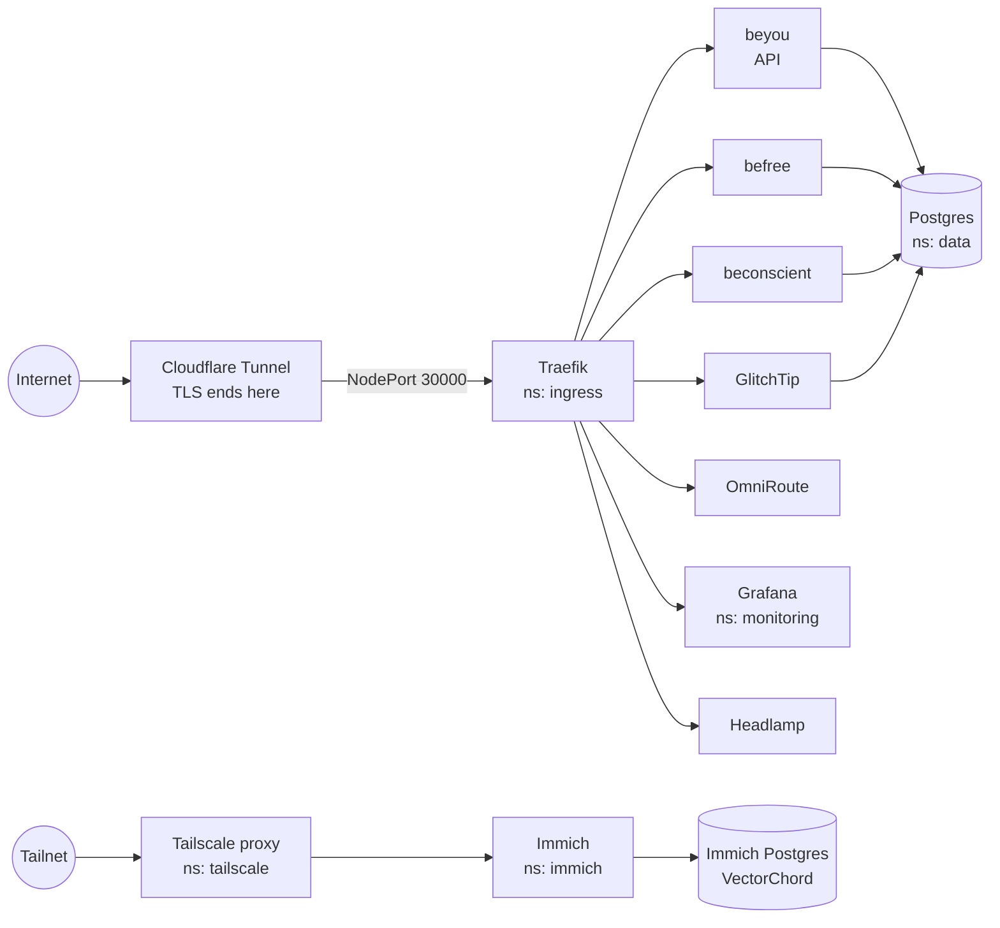

<div align="center">

# be-infra

[](https://fluxcd.io)
[](https://k3s.io)
[](https://cloudnative-pg.io)
[](https://getsops.io)

GitOps for `beyou-server`, a single-node k3s cluster where each app runs fenced off in its own namespace, applied from this repository by Flux.

[Overview](#overview) • [Getting started](#getting-started) • [Making a change](#making-a-change) • [Monitoring](#monitoring) • [Database](#database) • [Secrets](#secrets) • [Apps](#apps) • [Bootstrapping](#bootstrapping-a-new-cluster)

</div>

Every workload on the node is described here. That covers the beyou, befree and beconscient apps, GlitchTip, OmniRoute, Immich, the shared Postgres, the ingress and the monitoring stack. Flux watches `main` and applies it, so git always shows what is running. Nothing runs in Docker on the node any more.

> [!NOTE]
> This repository is public. Every Secret in it is encrypted with SOPS; read [Secrets](#secrets) before adding one.

## Overview



The Cloudflare Tunnel on the host sends every hostname to NodePort 30000, and Traefik routes on the Host header to each app's Ingress. k3s ships its own Traefik, but it is disabled on this node (`--disable traefik`), so the one in `platform/traefik/` is the only ingress controller. No app has a NodePort.

Private apps skip all of that. An Ingress with `ingressClassName: tailscale` gets its own proxy pod from the Tailscale operator and its own name on the tailnet, with a Let's Encrypt certificate. Those apps have no beyouweb.com hostname, so they are unreachable through the tunnel, from the internet and from the LAN.

| Namespace | What runs there | Hostnames | Deployed by |
|---|---|---|---|
| `beyou` | Spring Boot backend, nightly backup | api.beyouweb.com | Image automation |
| `befree` | nginx + Quarkus backend | befree.beyouweb.com | Image automation |
| `beconscient` | nginx + backend, nightly backup of its database and befree's | beconscient.beyouweb.com | Image automation |
| `glitchtip` | GlitchTip 6 + Valkey | mnt.beyouweb.com | Pinned digest, by hand |
| `omniroute` | OmniRoute + Redis | omniroute.beyouweb.com | Pinned digest, by hand |
| `immich` | Immich server and machine learning, Valkey, its own Postgres with VectorChord | immich.tail2f18c7.ts.net (tailnet only) | Pinned digest, by hand |
| `apscrap` | Nightly CronJob: rental-listing crawl, static site published to Cloudflare Pages, Telegram alert; nightly backup | apscrap.beyouweb.com (Cloudflare Pages, not this node) | Image automation |
| `data` | Postgres 17, one database and role per app | | CloudNativePG |
| `monitoring` | Prometheus, Grafana, Loki, Alloy | obs.beyouweb.com | Helm and manifests, pinned versions |
| `headlamp` | Headlamp with the Flux plugin | headlamp.beyouweb.com | Helm, pinned chart |
| `ingress` | Traefik | | Helm, pinned chart |
| `cnpg-system` | The CloudNativePG operator | | Helm, pinned chart |
| `tailscale` | The Tailscale operator and one proxy per tailnet Ingress | | Helm, pinned chart |

### How Flux applies it

`clusters/beyou-server/` declares one Flux `Kustomization` per piece. A broken app never blocks the others, and `flux get kustomizations` shows the health of each.

| Kustomization | Path | Waits for |
|---|---|---|
| `platform` | `platform/` (Traefik, Headlamp, CloudNativePG) | |
| `monitoring` | `platform/monitoring/` | `platform` |
| `monitoring-targets` | `platform/monitoring/targets/` | `monitoring`, whose CRDs it needs |
| `data` | `data/` | `platform`, `monitoring` |
| `befree`, `beconscient` | `apps/<app>/` | `platform`, `data` |
| `beyou`, `glitchtip` | `apps/<app>/` | `platform`, `data`, `monitoring` |
| `omniroute` | `apps/omniroute/` | `platform` |
| `tailscale` | `platform/tailscale/` | |
| `immich` | `apps/immich/` | `platform` |
| `apscrap` | `apps/apscrap/` | `platform`, `data` |

### Repository layout

| Path | What it is |
|---|---|
| `clusters/beyou-server/` | Flux entry point: the Kustomizations above |
| `clusters/beyou-server/flux-system/` | Flux's own components, generated by `flux bootstrap` |
| `platform/traefik/` | The ingress controller |
| `platform/cnpg/` | The CloudNativePG operator, which runs the shared Postgres |
| `platform/headlamp/` | Web UI for the cluster |
| `platform/tailscale/` | The Tailscale operator, the way into the tailnet-only apps (its own Kustomization) |
| `platform/monitoring/` | Prometheus, Grafana, Loki, Alloy, alert rules and dashboards |
| `platform/monitoring/targets/` | Scrape targets for platform pieces outside the `monitoring` namespace |
| `data/` | The shared Postgres: one cluster, a database and a role per app |
| `apps/<app>/` | Namespace, quota, network policies, encrypted secrets, workloads, Ingress |
| `scripts/` | Git hooks, and the one-off scripts that built the encrypted Secrets during the move from compose |

## Getting started

### Prerequisites

- `kubectl` with access to the cluster (on the server the kubeconfig is `/etc/rancher/k3s/k3s.yaml`)
- The [Flux CLI](https://fluxcd.io/flux/installation/#install-the-flux-cli)
- [SOPS](https://getsops.io), with the age private key from the password manager at `~/.config/sops/age/keys.txt`
- [gitleaks](https://github.com/gitleaks/gitleaks), which the pre-commit hook runs

### Set up a clone

```sh
git clone git@github.com:AndDev741/be-infra.git
cd be-infra
scripts/install-hooks.sh
```

The hook runs gitleaks on the staged changes and refuses any `kind: Secret` file that is not sops-encrypted. Run it once per clone.

## Making a change

Commit and push to `main`. Flux picks it up within a few minutes. To apply it now and check the result:

```sh
flux reconcile kustomization <name> --with-source
flux get kustomizations
```

> [!WARNING]
> Changes made with `kubectl` to anything Flux manages are reverted on the next reconcile. That includes `kubectl set image`: a new image is deployed by committing its tag or digest here.

### New images

befree, beconscient and the beyou backend deploy through Flux image automation (each app's `images.yaml`). When CI pushes a new `latest` to GHCR, Flux commits the digest to the `$imagepolicy` marker in the manifest and rolls it out, within about five minutes.

```sh
git revert <commit>                 # roll back a bad build
flux suspend image update <app>     # hold deploys back
flux resume image update <app>
```

GlitchTip, OmniRoute and their caches are pinned by digest and updated by hand.

## Monitoring

Grafana is at https://obs.beyouweb.com. The admin login is in `platform/monitoring/secrets/grafana-admin.sops.yaml`.

| Piece | What it covers | Kept for |
|---|---|---|
| Prometheus (kube-prometheus-stack) | The host through node-exporter, every pod and container through the kubelet, the cluster's own state through kube-state-metrics, and every app's ServiceMonitor or PodMonitor | 15 days, capped at 8 GB |
| Loki, fed by Alloy | The logs of every pod, labelled with `namespace`, `pod`, `container` and `app` | 30 days |
| Grafana alerting | Rules on host memory, swap and disk, container restarts, stuck pods, Deployments missing replicas and scrape targets that are down. Sent by email | |
| GlitchTip (https://mnt.beyouweb.com) | Error tracking, uptime monitors on each component's health endpoint, heartbeats for the scheduled jobs and backups | 30 days |

- **Dashboards** are ConfigMaps labelled `grafana_dashboard: "1"`, in any namespace. The `grafana_folder` annotation picks the folder.
- **bePresent · Immich** (folder bePresent) shows the photo library from Immich's own Postgres (counts, places, people, a map, the processing pipeline, the Snapchat import), next to the server's memory, swap, load, CPU temperature and disks, Immich's pods, restarts across the cluster and the ML scheduler's log. It is generated by `scripts/build-bepresent-dashboard.py`; change the queries there, not in Grafana.
- **Scraping is trimmed.** On k3s the kubelet and API server endpoints each serve the metrics of the whole k3s binary, so each job keeps only its own, and histogram buckets nothing reads are dropped (`kube-prometheus-stack.yaml`). Scrapes run every 60s.
- **An app declares its own scraping** with a ServiceMonitor or PodMonitor in its namespace, plus a NetworkPolicy letting the `monitoring` namespace in. befree and beconscient expose no metrics endpoint yet.

> [!TIP]
> Grafana reads dashboards only when it starts, because its sidecars run once as init containers to save memory. After adding or changing a dashboard, run `kubectl -n monitoring rollout restart deploy/grafana`.

### Headlamp

Headlamp at https://headlamp.beyouweb.com sits behind Cloudflare Access (a one-time PIN to the owner's email, configured in the Cloudflare dashboard). It then asks for a ServiceAccount token:

```sh
kubectl -n headlamp get secret headlamp-admin-token -o jsonpath='{.data.token}' | base64 -d
```

The Headlamp pod has no cluster rights of its own; every request runs with the token you sign in with. Deleting that Secret revokes every session, and Flux recreates it with a new token.

## Database

One CloudNativePG cluster, `pg` in the `data` namespace (`data/postgres.yaml`). Each app gets a role and a database declared there, a basic-auth Secret for the role's password in `data/secrets/`, and its namespace in `data/network-policy.yaml`. Apps connect to `pg-rw.data.svc:5432`.

| Database | Owner | Other roles |
|---|---|---|
| `beyou` | `beyou` | `beyou_readonly` (Grafana's product dashboard) |
| `glitchtip` | `glitchtip` | |
| `befree` | `befree` | `beconscient_backup` (SELECT, for the nightly dump), `befree_readonly` (Grafana's beFree dashboard) |
| `beconscient` | `beconscient` | `beconscient_backup` (SELECT, for the nightly dump), `beconscient_readonly` (Grafana's beConscient dashboard) |

### Grants

Grants beyond ownership are given once by the owner and also cover tables created later:

```sql
-- in beyou, as beyou
GRANT USAGE ON SCHEMA public TO beyou_readonly;
GRANT SELECT ON ALL TABLES IN SCHEMA public TO beyou_readonly;
ALTER DEFAULT PRIVILEGES FOR ROLE beyou IN SCHEMA public GRANT SELECT ON TABLES TO beyou_readonly;

-- in befree as befree, and in beconscient as beconscient
GRANT USAGE ON SCHEMA public TO beconscient_backup;
GRANT SELECT ON ALL TABLES IN SCHEMA public TO beconscient_backup;
GRANT SELECT ON ALL SEQUENCES IN SCHEMA public TO beconscient_backup;
ALTER DEFAULT PRIVILEGES FOR ROLE <owner> IN SCHEMA public GRANT SELECT ON TABLES TO beconscient_backup;
ALTER DEFAULT PRIVILEGES FOR ROLE <owner> IN SCHEMA public GRANT SELECT ON SEQUENCES TO beconscient_backup;

-- in befree, as befree: the dashboard's tables only. Not chat_memory or
-- app_users, and not transactions.rawinput (the message as typed).
GRANT USAGE ON SCHEMA public TO befree_readonly;
GRANT SELECT ON categories, budgets, goals, goal_contributions, inbound_messages,
  app_settings, month_starts TO befree_readonly;
GRANT SELECT (id, amount, type, currency, occurredon, description, category_id,
  source, external_id, createdat, goal_id) ON transactions TO befree_readonly;

-- in beconscient, as beconscient: no credentials (app_users, pairing_codes,
-- installations' hash and fingerprint) and no quarantined payloads.
GRANT USAGE ON SCHEMA public TO beconscient_readonly;
GRANT SELECT ON devices, raw_events, batch_log, segments, raw_intervals, unlocks,
  blocks, dirty_blocks, derivation_state, categories, subject_mappings,
  window_settings, non_workdays, computer_labels, sensor_coverage,
  device_counters, interval_conflicts, validation_inputs TO beconscient_readonly;
GRANT SELECT (id, device_id, client_name, client_version, created_at,
  last_seen_at, revoked_at, clone_suspected, last_seq, last_tz)
  ON installations TO beconscient_readonly;
GRANT SELECT (id, device_id, installation_id, event_id, type, ts, reason,
  received_at) ON quarantine TO beconscient_readonly;
```

These two are per table, so a table added later needs its own grant.

No backup role gets `pg_read_all_data`. In a shared cluster that role would reach every app's database.

### Backups

Backups are logical and per app. restic encrypts them in the pod before they leave the cluster. Each one has a weekly restore drill that restores the latest snapshot into a throwaway Postgres and compares row counts with the live database.

| Job | What | Where |
|---|---|---|
| `beyou/backup` (03:20) | `beyou` database and uploads | restic on Cloudflare R2, heartbeat to GlitchTip |
| `beconscient/backup` (03:40) | `beconscient` and `befree` databases | restic on Cloudflare R2 |

```sh
kubectl -n <ns> create job --from=cronjob/backup backup-manual
kubectl -n <ns> create job --from=cronjob/restore-check restore-manual
```

> [!NOTE]
> There is no continuous (WAL) archiving yet, because the CloudNativePG barman plugin needs cert-manager. Keep the restic passwords in the password manager too; without them a lost disk also loses the backups.

## Isolation per app

- **ResourceQuota and LimitRange** (`apps/<app>/limits.yaml`) give each app a memory budget, so one app can never starve the node. There are no CPU limits, by design: a quota on CPU requests keeps scheduling honest, and CPU limits only throttle a node with idle cores.
- **NetworkPolicy** (`apps/<app>/network-policy.yaml`) denies all ingress, then allows only Traefik → nginx → backend → database. Egress is open.
- **One Flux Kustomization per app.**

k3s's NetworkPolicy controller admits a new pod's IP a moment after the pod starts. A pod that connects to another namespace straight away, from an init container say, can be refused once. That is why the backup jobs wait for Postgres first.

## Secrets

Secrets are committed encrypted with [SOPS](https://getsops.io) and [age](https://age-encryption.org) as `*.sops.yaml`. Only `data` and `stringData` are encrypted, so a diff still shows which Secret changed. Flux decrypts them in the cluster with the key in `flux-system/sops-age`.

```sh
sops apps/befree/secrets/befree-auth.sops.yaml   # edits in place and re-encrypts on save
```

The private key lives in `~/.config/sops/age/keys.txt` on the server and in the password manager.

> [!CAUTION]
> Anyone who ever gets the age key can read every secret in this repository's history. A leaked key means rotating the secrets themselves.

Two guards stop a secret going out in clear text: the pre-commit hook from `scripts/install-hooks.sh`, and GitHub secret scanning with push protection on the repository.

## Apps

### beyou

Moved from `Beyou-dev-env`'s compose stack. It runs the backend (api.beyouweb.com). Its database is `beyou` in the shared Postgres, its uploads the `beyou-uploads` volume.

The web app (app.beyouweb.com) and the docs site (docs.beyouweb.com) are not on this node. They are static files served by the Cloudflare Workers `beyou-web` and `beyou-docs`, which Beyou-Frontend and Beyou-docs-ui CI deploy with wrangler after their tests pass; each repository's `wrangler.jsonc` holds the custom domain. Both call api.beyouweb.com from the browser, so `CORS_ALLOWED_PATTERN` in `apps/beyou/secrets/beyou-backend.sops.yaml` lists both origins, comma-separated. A Cloudflare rollback (`wrangler rollback` or the dashboard) undoes a bad frontend build.

The backend's error DSN and heartbeat URLs name `glitchtip:8000`, as they did in compose; `apps/beyou/glitchtip.yaml` is an ExternalName alias to GlitchTip's own namespace. Local development still runs from `Beyou-dev-env`'s compose files, which no longer carry anything for production.

### befree

Manifests moved from `beFree/deploy`. Its database is `befree` in the shared Postgres. The `befree-db` Secret holds the role's credentials for the backend, and the same password is in `data/secrets/befree-db-owner.sops.yaml`, which sets it in Postgres. Change both together.

> [!IMPORTANT]
> The dev-only Secret in `beFree/deploy/00-namespace.yaml` is left out on purpose. Applying it would overwrite the production password.

### beconscient

Manifests moved from `beConscient/deploy`. Its database is `beconscient` in the shared Postgres, and its nightly backup (`apps/beconscient/backup.yaml`) also dumps befree's. The application-level procedures, such as keys and replaying collectors after a restore, are in `beConscient/deploy/README.md`.

### glitchtip

GlitchTip 6 at mnt.beyouweb.com runs web, worker and migrations in one process. Its Valkey keeps nothing across restarts and its database is in the shared Postgres. Browser SDKs reach it through Traefik and the backends through the Service. Its uptime monitors live in its database and point at cluster Services (`backend.beyou.svc:9091`, `pg-rw.data.svc:5432`, the monitoring stack), which is why those namespaces let `glitchtip` in on their health ports.

### omniroute

OmniRoute is the OpenAI-compatible gateway the beyou backend uses for its generic LLM provider, at omniroute.beyouweb.com (its `/v1` needs an API key). Its state is one SQLite file on the `omniroute-data` volume. It tracks the upstream `:next` tag, pinned by digest.

> [!CAUTION]
> `STORAGE_ENCRYPTION_KEY` and `API_KEY_SECRET` in OmniRoute's Secret are what make the stored provider keys readable. Never regenerate them.

### immich

Immich is the photo library behind bePresent, at https://immich.tail2f18c7.ts.net and only on the tailnet. The originals live on the 500 GB HDD at `/srv/media/immich`: ext4, `LABEL=media`, mounted on `/srv/media` by the host's fstab. They sit on a static volume with `Retain`, so no delete in the cluster ever removes a photo. Thumbnails, the ML models and Immich's Postgres are on the SSD.

Its Postgres is a separate CloudNativePG cluster, `immich-pg`, because Immich needs VectorChord and the shared one doesn't ship it. The `immich` role owns its database without being a superuser, so a vchord upgrade needs the statements in the header of `apps/immich/postgres.yaml`. Server and ML are pinned by digest: read the release notes, then move both digests together.

First install:

1. On the host, create the library folder for uid 1000: `sudo install -d -o 1000 -g 1000 /srv/media/immich`.
2. In the Tailscale admin console:
   - DNS: MagicDNS and HTTPS certificates on.
   - Access controls: `"tagOwners": {"tag:k8s-operator": ["autogroup:admin"], "tag:k8s": ["tag:k8s-operator"]}`.
   - Settings, Trust credentials: an OAuth client with write on Devices Core, Auth Keys and Services, tagged `tag:k8s-operator`. Then run `scripts/create-tailscale-operator-secret.sh`, which asks for its id and secret and writes `platform/tailscale/secrets/operator-oauth.sops.yaml`.
3. Open https://immich.tail2f18c7.ts.net, create the admin account, and in Administration, Settings, before the first import:
   - Jobs: concurrency 1 for every queue. The i3 has four threads and the other apps need some.
   - Machine learning: OCR off. Smaller models (buffalo_s, RN50) if the ML pod gets OOM-killed.
   - Storage template: on, so originals land in year and month folders that stay readable without Immich.

Grafana reads Immich's database as `grafana_readonly`, which may only SELECT the library tables. CloudNativePG creates the role from `postgres.yaml`; the grants are SQL in `scripts/grant-immich-grafana-readonly.sh`, to rerun if an Immich upgrade recreates a table.

Machine learning runs one model at a time. Immich would load the face and smart-search models together, about 1.5 GB, and on 2026-10-14 that pushed the node into swap and restarted pods across the cluster. `apps/immich/ml-scheduler.yaml` runs every five minutes, keeps at most one of the two queues unpaused and pauses both while the node has under 500 MB available. Its API key (queue permissions only) comes from `scripts/create-immich-ml-scheduler-secret.sh`. To see what it decided: `kubectl -n immich logs job/<latest immich-ml-scheduler job>`.

## Bootstrapping a new cluster

The node needs k3s installed with `--disable traefik` and a Cloudflare Tunnel sending each hostname to NodePort 30000. Then:

```sh
kubectl create namespace flux-system
kubectl -n flux-system create secret generic sops-age \
  --from-file=age.agekey=$HOME/.config/sops/age/keys.txt
GITHUB_TOKEN=$(gh auth token) flux bootstrap github \
  --owner=AndDev741 --repository=be-infra --branch=main \
  --path=clusters/beyou-server --personal \
  --read-write-key \
  --components-extra=image-reflector-controller,image-automation-controller
```

Flux then applies everything in the order shown in [How Flux applies it](#how-flux-applies-it). Databases and volumes start empty on a new cluster; their data lives in the restic repositories on R2.
